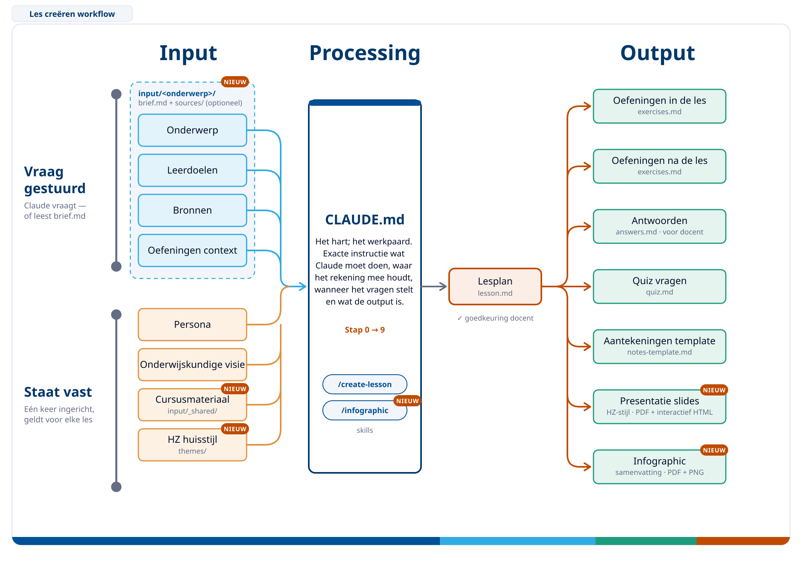

# Lesson Creation Workflow

A Claude-powered workflow for creating structured, educationally grounded lesson materials — including a lesson plan, exercises, an answer key, a self-assessment quiz, HZ-styled MARP slides (PDF + interactive HTML), a student note-taking template, and a one-page infographic — from a single conversation.



## What This Repo Is

This repository contains the configuration and context files that instruct Claude on how to generate complete lesson packages. It is built around three principles:

- **Educational quality**: All lessons are grounded in Ken Bain's research-backed teaching principles (from *What the Best College Teachers Do*), as described in `.claude/context/educational_context.md`.
- **Persona-aware design**: Lessons, exercises, and quiz questions are designed with three student archetypes in mind (HAVO, MBO, and non-traditional intake), as described in `.claude/context/persona.md`.
- **Structured output**: Each lesson produces a consistent set of files organized in its own folder.

## Output per Lesson

For every lesson, Claude creates a folder `lessons/<topic-slug>/` containing:

| File                   | Description                                             |
| ---------------------- | ------------------------------------------------------- |
| `lesson.md`            | Full lesson plan with learning objectives               |
| `exercises.md`         | In-class and follow-up exercises                        |
| `answers.md`           | Model answers and grading notes (teacher-facing)        |
| `quiz.md`              | 4 self-assessment questions for students (formative)    |
| `slides.md`            | MARP slide deck source                                  |
| `slides.pdf`           | Rendered PDF slide deck (HZ theme)                      |
| `slides.html`          | Interactive slide deck: click-to-reveal, presenter view |
| `notes-template.md`    | Guided Learning Log for students (Before/During/After)  |
| `infographic.pdf/.png` | One-page visual summary of the lesson                   |

## How to Use

Open this repository in [Claude Code](https://claude.ai/code) and start a new conversation. Claude will automatically load the workflow from `CLAUDE.md` and guide you through the following steps. You can also invoke it directly with `/create-lesson`:

0. **Input** *(optional)* — Prepare `input/<topic-slug>/` with a `brief.md` and source files beforehand, then run `/create-lesson <topic-slug>`. See [input/README.md](input/README.md)
1. **Topic** — Describe the lesson topic, target audience, and duration
2. **Sources** — Provide URLs, local files, or references to use as input
3. **Lesson plan** — Claude creates `lesson.md` (persona-aware) and asks for your approval
4. **Exercise context** — Specify format, collaboration style, and constraints
5. **Exercises** — Claude creates `exercises.md` with in-class and follow-up exercises, plus `answers.md` with model answers and grading notes
6. **Quiz** — Claude creates `quiz.md` with 4 persona-aware self-assessment questions for students
7. **Slides** — Claude creates `slides.md` with the HZ theme and renders it to `slides.pdf` and an interactive `slides.html`
8. **Notes template** — Claude creates `notes-template.md`, a Guided Learning Log students use before, during, and after the lesson to deepen processing
9. **Infographic** — Claude creates a one-page summary (`infographic.pdf` / `.png`)

Run `/infographic` at any time for an extra infographic of one topic (layouts: one-pager, process, compare, concept-map).

## Slide Design

Slides and infographics use the HZ themes in [themes/](themes/README.md): HZ colours, layouts per lesson section (question, poll, concept, activity, reflection…), and interaction in the HTML version (step-by-step bullets, click-to-reveal answers, QR codes for polls, presenter view with `p`). Open `themes/examples/showcase.md` or run `npm run showcase` to see all layouts.

## Requirements

- [Claude Code](https://claude.ai/code) CLI
- [Node.js](https://nodejs.org) — then run `npm install` once in this folder. This installs a pinned MARP CLI (`npx marp`) and a QR code generator, so no global `marp` install is needed

## Project Structure

```text
lesson-creation-workflow/
├── CLAUDE.md                          # Workflow instructions for Claude
├── README.md
├── workflow.svg                       # Workflow diagram
├── workflow.png                       # PNG export of the diagram
├── package.json                       # Pinned MARP CLI + QR code tool
├── .marprc.yml                        # MARP config: theme folder, HTML enabled
├── input/                             # Optional prepared input per lesson
│   ├── _shared/                       # Course-wide material
│   ├── _template/brief.md             # Copy per lesson
│   └── <topic-slug>/{brief.md,sources/}
├── themes/
│   ├── hz.css                         # HZ slide theme
│   ├── hz-infographic.css             # HZ infographic theme (A4)
│   ├── README.md                      # Layouts, components, interaction
│   └── examples/showcase.md           # All slide layouts in one deck
├── lessons/                           # Generated lesson folders (one per topic)
│   └── <topic-slug>/
│       ├── lesson.md
│       ├── exercises.md
│       ├── answers.md
│       ├── quiz.md
│       ├── slides.md
│       ├── slides.pdf
│       ├── slides.html
│       ├── notes-template.md
│       └── infographic.{md,pdf,png}
└── .claude/
    ├── context/
    │   ├── educational_context.md     # Bain-inspired teaching principles
    │   └── persona.md                 # Three student archetypes
    └── skills/
        ├── create-lesson/
        │   └── SKILL.md               # /create-lesson slash command
        └── infographic/
            ├── SKILL.md               # /infographic slash command
            └── templates/             # one-pager, process, compare, concept-map
```
